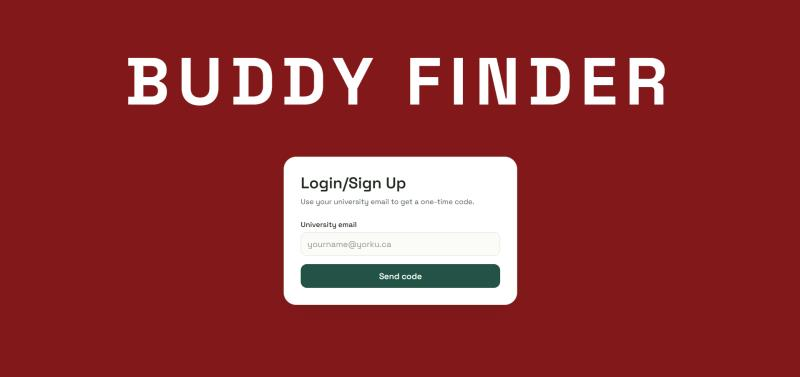
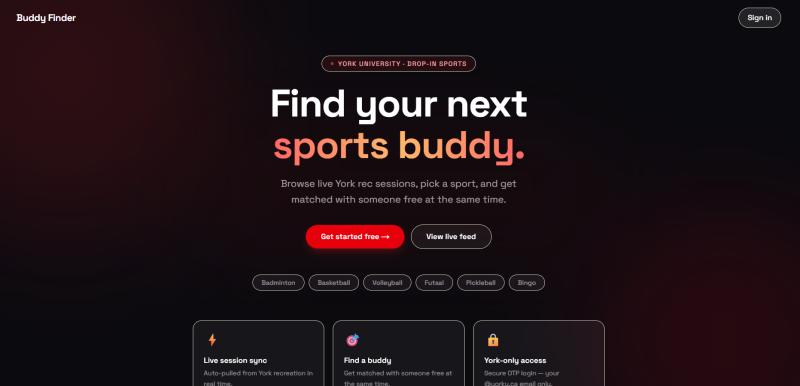
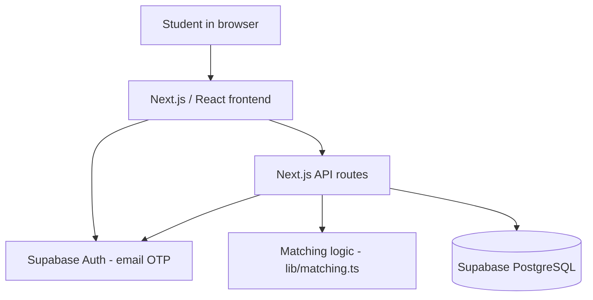

# Gym Connect | Buddy Finder

**Find your next sports buddy at York University.**

Gym Connect (branded **Buddy Finder** in the app) helps York University students discover drop-in recreation sessions and connect with other students who want to play the same sport at overlapping times.

**[Try the live app](https://gym-connect-three.vercel.app/)** · **[View the source code](https://github.com/shivanikadirgamarajah/gym-connect)**

## Why I built it

Joining a drop-in sport can feel intimidating when you don't know anyone who wants to play. I built Gym Connect to make finding recreation sessions and connecting with available students easier.

The project also explores a practical scheduling problem: finding meaningful overlaps between students' availability while avoiding duplicate and invalid matches.

## Features

- **Drop-in sports feed:** Browse sessions by sport, with links to York University's recreation schedule.
- **Availability-based buddy requests:** Choose a sport, preferred date, and time range.
- **Ranked matches:** Find other students who are available for at least 15 overlapping minutes, ranked by overlap length.
- **Pending requests:** Save a buddy request even when nobody currently matches.
- **Student profiles:** Add a display name and degree before accessing the feed.
- **In-app messaging:** Contact other students and see unread-message indicators.
- **Email-code sign-in:** Authenticate through Supabase Auth using a one-time email code; buddy requests require a York University email address.

---

## Preview

### Email-code sign-in



*Sign in with a university email address to receive a one-time code.*

### Landing page



*Explore the app and browse sports before finding a buddy.*

---

## How matching works

The matching algorithm is implemented in [`lib/matching.ts`](lib/matching.ts) and called by [`app/api/buddy/request/route.ts`](app/api/buddy/request/route.ts).

Two buddy requests are eligible to match when:

1. They belong to **different students**.
2. They have the **same sport** (compared without case differences or surrounding whitespace).
3. They have the **same preferred date**.
4. Both time ranges are valid `HH:mm` ranges, with the start before the end.
5. Their availability overlaps by **at least 15 minutes**.

### Overlap calculation

The algorithm converts time values into minutes and calculates:

```text
overlap_minutes = max(0, min(end_a, end_b) - max(start_a, start_b))
```

### Example

Student A is available from **3:00 PM to 4:00 PM**.

| Student | Availability | Overlap | Result |
| --- | --- | --- | --- |
| Student B | 3:30–4:30 PM | 30 minutes | Match |
| Student C | 3:45–5:00 PM | 15 minutes | Match |
| Student D | 3:50–5:00 PM | 10 minutes | No match |
| Student E | 4:00–5:00 PM | 0 minutes | No match |

### Ranking and edge cases

If several requests belong to the same candidate student, the algorithm keeps that student's best overlap.

Eligible candidates are sorted by:

1. **Overlap duration:** Highest first.
2. **Request ID:** Deterministic tie-breaker.

The matching logic also handles:

- Self-matches
- Invalid time ranges
- Different sports or preferred dates
- Non-overlapping availability
- Boundary conditions
- Duplicate candidate requests

---

## Architecture

Gym Connect uses Next.js for the application frontend and API routes, Supabase for authentication and data storage, and a dedicated TypeScript module for matching.



### Buddy-request flow

1. A signed-in student submits a sport, date, and availability window.
2. `POST /api/buddy/request` checks authentication, verifies the York email domain, and validates required fields.
3. The route records the new request and fetches candidate requests for the same sport and date.
4. `findMatches()` applies the overlap rules, removes duplicate students, and ranks matches.
5. The API saves successful matches to `buddy_matches` and returns matching students.
6. If no match is found, the request remains open for future matching.

Server-side administrative database operations use a private Supabase service-role key.

---

## Tech stack

| Layer | Technology |
| --- | --- |
| Application | Next.js 16 (App Router), React 19 |
| Language and styling | TypeScript, Tailwind CSS 4 |
| Authentication | Supabase Auth (email OTP) |
| Database | Supabase PostgreSQL |
| Testing and code quality | Vitest, ESLint, TypeScript |
| Deployment | Vercel |

---

## Local development

### Prerequisites

Before starting, ensure you have:

- Node.js and npm compatible with Next.js 16
- A Supabase project
- A configured Supabase email authentication provider
- Git installed

### 1. Clone the repository

```bash
git clone https://github.com/shivanikadirgamarajah/gym-connect.git
cd gym-connect
```

### 2. Install dependencies

```bash
npm ci
```

### 3. Configure environment variables

Copy the example environment file:

```bash
cp .env.example .env.local
```

Update `.env.local` with values from your Supabase project.

| Variable | Purpose |
| --- | --- |
| `NEXT_PUBLIC_SUPABASE_URL` | Supabase project URL |
| `NEXT_PUBLIC_SUPABASE_PUBLISHABLE_KEY` | Public client key; alternatively use `NEXT_PUBLIC_SUPABASE_ANON_KEY` |
| `SUPABASE_SERVICE_ROLE_KEY` | Server-only secret used by administrative database operations |

**Security considerations:**

- Never commit `.env.local` to version control.
- Never expose the service-role key in frontend code.
- Never prefix the service-role key with `NEXT_PUBLIC_`.
- Configure appropriate database access policies for your Supabase project.

### 4. Configure Supabase

**Important:** This repository does not yet contain a complete set of database migrations and Supabase setup instructions.

Cloning the repository and configuring environment variables alone is not sufficient to reproduce every feature locally.

A working Supabase instance requires:

- The expected database schema
- Tables including `buddy_requests` and `buddy_matches`
- Appropriate access policies
- Configured email OTP authentication

Until reproducible migrations are added, the [live demo](https://gym-connect-three.vercel.app/) is the easiest way to explore the application.

### 5. Start the development server

```bash
npm run dev
```

Open [http://localhost:3000](http://localhost:3000).

---

## Testing and validation

The project uses Vitest for unit testing, ESLint for static analysis, and TypeScript for type checking.

### Run tests

```bash
npm test
```

### Run tests in watch mode

```bash
npm run test:watch
```

### Run ESLint

```bash
npm run lint
```

### Check TypeScript

```bash
npx tsc --noEmit
```

### Verify production build

```bash
npm run build
```

### Matching test coverage

The matching tests cover:

| Test scenario | Expected behavior |
| --- | --- |
| Sufficient overlap | Match accepted |
| Less than 15 minutes overlap | Match rejected |
| Different sports | Match rejected |
| Different dates | Match rejected |
| No overlapping time | Match rejected |
| Invalid time ranges | Match rejected |
| Same student | Self-match prevented |
| Duplicate candidates | Best match retained |
| Multiple candidates | Ranked by overlap duration |
| Boundary conditions | Correct handling of exact overlap limits |

**Testing limitations:** Unit tests validate matching logic but do not replace integration testing against a configured Supabase project.

Authentication, database persistence, and messaging should also be verified through integration and end-to-end tests before production changes.

---

## API reference

### Create a buddy request

`POST /api/buddy/request`

Creates an availability request and searches for matching students.

**Authentication:** Requires an authenticated session associated with a York University email address.

### Example request

```json
{
  "sport_name": "Basketball",
  "display_name": "Alex",
  "degree": "Computer Science",
  "preferred_date": "2026-11-20",
  "preferred_time_start": "15:00",
  "preferred_time_end": "16:00",
  "session_key": "example-session-key"
}
```

The `session_key` corresponds to a selected recreation session in the application. The example above is illustrative.

### Match found

A successful match response contains:

```json
{
  "matched": true,
  "buddies": []
}
```

The `buddies` array contains the matching students when matches are available. The empty array above is a simplified illustration of the response shape.

### No match found

```json
{
  "matched": false
}
```

The request remains available for future matching.

### Error handling

| HTTP status | Meaning |
| --- | --- |
| `400` | Required fields are missing or invalid |
| `401` | User is not authenticated |
| `403` | User does not have an accepted York University email |
| `429` | Request limit reached |
| `500` | Server or database operation failed |

This endpoint is intended for authenticated application use, not unauthenticated public access.

---

## Data and security

### Data storage

The application uses Supabase PostgreSQL to store student-related application data.

**`buddy_requests`**

Stores submitted availability requests and request statuses, including:

- `open`
- `matched`
- `cancelled`

**`buddy_matches`**

Associates pairs of compatible buddy requests.

### Authentication

Supabase Auth handles email-based authentication.

The buddy-request API verifies the authenticated user and checks the email domain before performing server-side database operations.

### Security practices

- Private administrative credentials remain server-side.
- Client-facing keys are separated from private service-role credentials.
- Authentication is checked before protected buddy-request operations.
- Database permissions and access policies must be configured for each deployment.

A complete database schema, migrations, and access-policy reference remain planned improvements.

---

## Troubleshooting

| Problem | Recommended action |
| --- | --- |
| Supabase configuration error | Verify `.env.local` values and restart the development server |
| Email authentication code does not arrive | Check Supabase email settings, sending limits, and spam folder |
| Buddy request returns `401` | Sign in again and confirm the session is valid |
| Buddy request returns `403` | Verify that the account uses an accepted York University email |
| No matching students appear | Confirm another student has the same sport and date with at least 15 minutes of overlap |
| Buddy request returns `500` | Inspect server logs, database schema, service-role configuration, and permissions |
| Local setup does not work | Confirm that your Supabase database contains the required schema and policies |

---


## Contributing

Contributions, bug reports, and suggestions are welcome.

### How to contribute

1. Open an issue describing the bug or proposed improvement.
2. Fork the repository or create a focused feature branch.
3. Implement the change.
4. Run the appropriate checks:

```bash
npm test
npm run lint
npx tsc --noEmit
npm run build
```

5. Open a pull request describing the change and how it was tested.

Please keep pull requests focused and include clear reproduction steps for bug fixes.

---

## Project status

Gym Connect is an independently developed student project.

It is not an official York University service and is not endorsed by York University.

**[Try Gym Connect](https://gym-connect-three.vercel.app/)**
