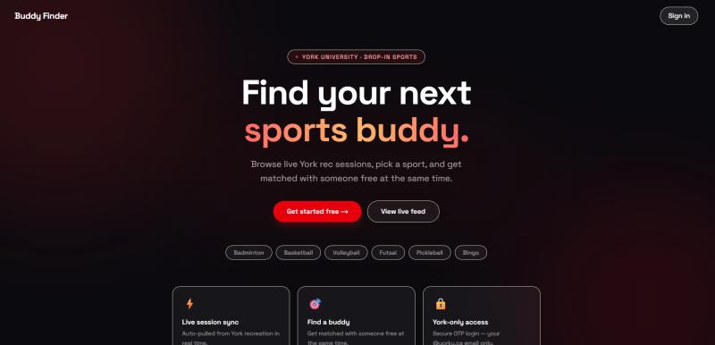

# Gym Connect | Buddy Finder

**Find a sports buddy at York University.**

Gym Connect (currently branded **Buddy Finder** in the app) helps York University students discover drop-in recreation sessions and find other students who want to play the same sport at overlapping times.

**[Try the live app](https://gym-connect-three.vercel.app/)**

## Why I built it

It can be difficult to join a drop-in sport when you don't know anyone else who wants to play. This project makes it easier to discover recreation opportunities and connect with students who are available at the same time.

## Features

- **Drop-in sports feed:** Browse active sessions organized by sport, with links to York's recreation schedule.
- **Availability-based buddy requests:** Select a sport, preferred date, and time range to look for other interested students.
- **Match results:** See matching students when their availability overlaps, or save a request when no match is available yet.
- **Student profiles:** Complete a profile with a display name and degree before accessing the feed.
- **Messaging:** Communicate with other students through the app, with unread-message indicators.
- **Email-code authentication:** Sign in using a one-time code sent through Supabase Auth. The application is designed for York University students.
  
---

## Preview




---

## Tech stack

| Layer | Technology |
| --- | --- |
| Framework | Next.js 16 (App Router) |
| Frontend | React 19, TypeScript, Tailwind CSS 4 |
| Authentication and data | Supabase |
| Deployment | Vercel |

### Setup

```bash
git clone https://github.com/shivanikadirgamarajah/gym-connect.git
cd gym-connect
npm install
```

Copy the example file to `.env.local` in the project root:

```bash
cp .env.example .env.local
```

Set the Supabase values in `.env.local`. You can use `NEXT_PUBLIC_SUPABASE_ANON_KEY` instead of the publishable-key variable if your project uses an anon key. The service-role key is only needed for server-side admin operations; never expose it as a `NEXT_PUBLIC_*` variable or commit `.env.local`.

Then run:

```bash
npm run dev
```

Open [http://localhost:3000](http://localhost:3000).

**Note:** Environment variables alone are not enough for a fully working local instance. The app also needs a compatible Supabase database schema, access policies, and email authentication configuration. Database setup instructions or migrations can be added to this repository.
